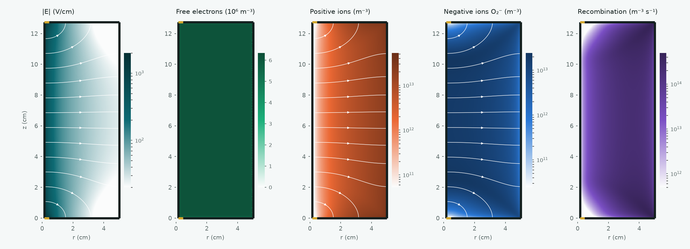

# FESTIM - Ion chambers

A companion package for [FESTIM](https://github.com/festim-dev/FESTIM) to model
tritium ionisation chambers (in-line process monitors). It adds charge carriers, an
electric potential and chamber quantities to FESTIM's own classes. The goal is a model
for exploring chamber design: the linear range, memory effects and the detection
threshold.

**Status:** prototype. The model runs for a generic coaxial chamber in room air. It
has not been validated against measurements.



*The electric field, the densities of the three charge carriers and the recombination
rate in a 1 L coaxial chamber in air at 500 V and 100 Ci/m³, in the half section
(r, z). The lines are electric field lines.*

## Setup

```bash
conda env create -f environment.yml
conda activate ion-chambers-env
pip install -e .
```

This gives FESTIM 2.2 on DOLFINx 0.11, from conda-forge.

Check the installation with the tests:

```bash
python -m pytest
```

## Example

The package is used like FESTIM: an `ElectrostaticProblem` gives the electric
potential, then a `ChargeTransportProblem` moves the charge carriers in it.

```python
import ion_chambers as ic

chamber = ic.CoaxialChamber(rod_radius=1.5e-3, can_radius=0.05, length=0.127)

# 1. the electric potential
electrostatics = ic.ElectrostaticProblem()
electrostatics.mesh = chamber.create_mesh(radial_cells=120, axial_cells=72)
electrostatics.subdomains = [chamber.gas, chamber.anode, chamber.cathode]
electrostatics.boundary_conditions = [
    ic.FixedPotentialBC(subdomain=chamber.anode, value=500.0),  # V
    ic.FixedPotentialBC(subdomain=chamber.cathode, value=0.0),
]
electrostatics.initialise()
electrostatics.run()

# 2. the gas: you define the charge carriers and their reactions
electrons = ic.ChargeCarrier(name="e", charge=-1, mobility=0.04, diffusivity=0.04)
positive_ions = ic.ChargeCarrier(name="P", charge=1, mobility=2.0e-4)
negative_ions = ic.ChargeCarrier(name="N", charge=-1, mobility=2.2e-4)

air = ic.Gas(
    name="air",
    w_value=33.97,  # eV per ion pair
    density=1.205,  # kg/m3
    carriers=[electrons, positive_ions, negative_ions],
    ionisation_products=(electrons, positive_ions),
    reactions=[
        # attachment of electrons to O2
        ic.CarrierReaction(reactant=electrons, product=negative_ions, rate=1.0e8),
        # recombination
        ic.CarrierReaction(reactant=[positive_ions, negative_ions], rate=2.0e-12),
        ic.CarrierReaction(reactant=[positive_ions, electrons], rate=2.0e-13),
    ],
)

# 3. the transport of the charge carriers
current = ic.ChamberCurrent(surface=chamber.anode)
collection_efficiency = ic.CollectionEfficiency(volume=chamber.gas)

transport = ic.ChargeTransportProblem()
transport.electrostatic_problem = electrostatics
transport.gas = air
transport.ionisation_sources = [
    ic.TritiumInGas(activity=3.7e10, geometry=chamber)  # Bq/m3
]
transport.exports = [current, collection_efficiency]
transport.initialise()
transport.run()

print(current.value, collection_efficiency.value)
```

The classes are children of FESTIM's: the problems, `ChargeCarrier` (a species),
`CarrierReaction` (a reaction), `FixedPotentialBC` and the exports. The package ships
no gas data: `examples/reference_case.py` is a fuller air example that follows the
pressure.
