# Walkthrough: a chamber model, step by step

This page builds the model of a 1 L ionisation chamber filled with tritiated
air, one component at a time, and ends with the quantities the model gives. The last
part shows how FESTIM could be coupled to it to study memory effects.

All values are in SI units. **The gas and wall data are illustrative, not reference
data.**

The [theory](theory.md) page explains each mechanism with drawings and animations.
This page is the same story in equations and code. The code blocks run in order, as a
script or in a notebook, and the outputs shown are those of the 1 L chamber defined
below.

## The big picture

An ionisation chamber measures the tritium activity of a gas. It is a metal can
filled with the gas, with a rod in the middle and a voltage between the two. The
drawing below follows one decay.

```python
import festim as F
import matplotlib.pyplot as plt
import numpy as np
from dolfinx import fem

import ion_chambers as ic
from ion_chambers.constants import BQ_PER_CI
```

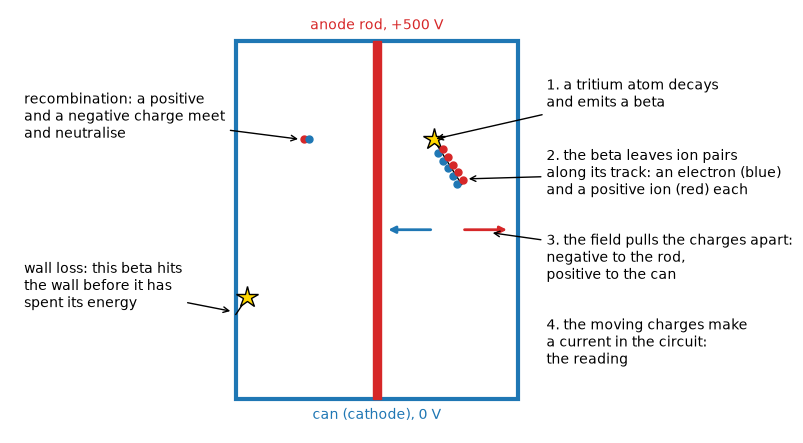

### Every mechanism, in order

| | Mechanism | What happens | Scale | In the model |
|---|---|---|---|---|
| 1 | **Beta decay** | A tritium nucleus turns into helium-3 and emits a fast electron, the beta. | 5.7 keV on average, 18.6 keV at most | beta spectrum (section 4) |
| 2 | **Ionisation** | The beta knocks electrons out of the gas molecules it passes. Each one leaves a free electron and a positive ion: an *ion pair*. | 168 pairs within 0.4 mm | source $S$ (section 4) |
| 3 | **Wall loss** | A beta emitted near a wall hits the metal before it has spent its energy. | within 5 mm of a wall | efficiency $f(r, z)$ (section 4) |
| 4 | **Attachment** | A free electron sticks to an O₂ molecule and becomes a negative ion. | after 10 ns | reaction (section 3) |
| 5 | **Drift** | The field pulls positive ions to the can and negative charges to the rod. | 0.6 to 19 m/s, 44 ms to cross | drift term (sections 3, 5) |
| 6 | **Diffusion** | Random thermal motion spreads the charges. | under 1 mm during the crossing | diffusion term (section 5) |
| 7 | **Recombination** | A positive and a negative ion meet and neutralise. Their charge never reaches the electrodes. | grows with the square of the activity | reaction (section 3) |
| 8 | **Collection** | The charges that reach an electrode are absorbed. Their motion on the way is the current. | | boundary conditions, `ChamberCurrent` (sections 5, 6) |

Each one is explained where it enters the model.

### What we want to understand

If every beta stopped in the gas and every charge were collected, the current would
be

$$
I_\mathrm{ideal} = e \, A \, V_\mathrm{gas} \, \frac{\bar{E}}{W}
$$

with $A$ the activity concentration (Bq/m³, decays per second and per m³),
$V_\mathrm{gas}$ the gas volume, $\bar{E}$ the mean beta energy and $W$ the energy
needed to make one ion pair. In words: decays per second, times pairs per decay,
times the charge of one pair.

A real chamber reads less, because of mechanisms 3 and 7:

$$
I = I_\mathrm{ideal} \times \eta_\mathrm{wall} \times \eta_\mathrm{collection}
$$

- $\eta_\mathrm{wall}$ is the share of the beta energy that stays in the gas.
- $\eta_\mathrm{collection}$ is the share of the ion pairs that escape
  recombination.

**The aim is to know how these two efficiencies depend on the chamber** (shape,
voltage, gas) **and on the activity.** That tells us over which range the current is
proportional to the activity, which is what makes the chamber usable as a monitor.

## The model in one table

| Step | Question | Object |
|---|---|---|
| 1 | Where are the walls? | `CoaxialChamber` |
| 2 | What is the electric field? | `ElectrostaticProblem` |
| 3 | Which charges exist and how do they move and react? | `Gas`, `ChargeCarrier`, `CarrierReaction` |
| 4 | Where are ion pairs created? | `TritiumInGas` |
| 5 | Where do the charges go? | `ChargeTransportProblem` |
| 6 | What does the chamber read? | exports, such as `ChamberCurrent` |

Two small helpers to plot a field on the mesh and along a radial line. They are only
for this page.

```python
def values_at_nodes(field):
    """The node coordinates, the triangles and the value of a field at the nodes."""
    mesh = field.function_space.mesh
    V1 = fem.functionspace(mesh, ("Lagrange", 1))
    field_at_nodes = fem.Function(V1)
    field_at_nodes.interpolate(field)
    coordinates = V1.tabulate_dof_coordinates()
    triangles = V1.dofmap.list
    return coordinates[:, 0], coordinates[:, 1], triangles, field_at_nodes.x.array


def plot_field(field, label, **kwargs):
    """A colour map of a field over the (r, z) half section of the chamber."""
    r, z, triangles, values = values_at_nodes(field)
    plt.figure(figsize=(4.5, 5))
    plt.tripcolor(r * 1e3, z * 1e3, triangles, values, shading="gouraud", **kwargs)
    plt.colorbar(label=label)
    plt.xlabel("r (mm)")
    plt.ylabel("z (mm)")
    plt.gca().set_aspect("equal")


def radial_profile(field, height):
    """The value of a field along the radius, at a given height."""
    r, z, _, values = values_at_nodes(field)
    on_line = np.isclose(z, height, atol=1e-9)
    order = np.argsort(r[on_line])
    return r[on_line][order], values[on_line][order]
```

## 1. The chamber

An anode rod on the axis of a closed cylindrical can. The can and its end caps are
the cathode. The chamber is axisymmetric, so the model only needs the $(r, z)$ half
section of the gas.

```python
chamber = ic.CoaxialChamber(
    rod_radius=1.5e-3,  # m
    can_radius=0.05,  # m
    length=0.127,  # m
)
print(f"gas volume  {chamber.volume * 1e3:.3f} L")
```

```text
gas volume  0.997 L
```

### The mesh

`create_mesh` divides the gas into cells of equal size: `radial_cells` from the rod
to the can and `axial_cells` from one end cap to the other. Each rectangle is cut
into four triangles. A coarse mesh is drawn here so that the cells are visible. The
calculation below uses 100 × 60 cells.

```python
coarse_mesh = chamber.create_mesh(radial_cells=20, axial_cells=12)
nodes = coarse_mesh.mesh.geometry.x
triangles = coarse_mesh.mesh.geometry.dofmaps[0]

plt.figure(figsize=(4.5, 5))
plt.triplot(nodes[:, 0] * 1e3, nodes[:, 1] * 1e3, triangles, linewidth=0.4)
plt.xlabel("r (mm)")
plt.ylabel("z (mm)")
plt.gca().set_aspect("equal")
plt.title("anode rod on the left, can on the right")
plt.show()
```

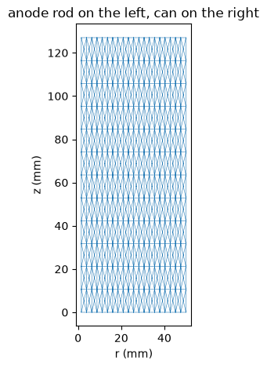

## 2. The electric potential

The charges move in the electric field $E = -\nabla\varphi$. The potential
$\varphi$ obeys Poisson's equation

$$
-\nabla \cdot (\varepsilon_0 \nabla \varphi) = \rho
$$

with $\varphi = 500$ V on the anode, $\varphi = 0$ on the cathode and no normal
field on the insulators. We neglect the charge of the gas itself ($\rho = 0$), so
the potential is solved once, before the transport. Section 6 checks that
assumption.

`ElectrostaticProblem` plays the role `festim.HeatTransferProblem` plays for
hydrogen transport: it is solved first and handed to the transport problem.

```python
BIAS = 500.0  # V

electrostatics = ic.ElectrostaticProblem()
electrostatics.mesh = chamber.create_mesh(radial_cells=100, axial_cells=60)
electrostatics.subdomains = [chamber.gas, chamber.anode, chamber.cathode]
electrostatics.boundary_conditions = [
    ic.FixedPotentialBC(subdomain=chamber.anode, value=BIAS),
    ic.FixedPotentialBC(subdomain=chamber.cathode, value=0.0),
]
electrostatics.initialise()
electrostatics.run()

plot_field(electrostatics.potential, label="potential (V)")
plt.show()
```

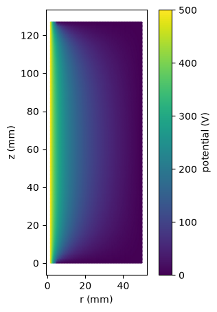

Away from the end caps, the potential is close to that of an infinite coaxial cable
(the grounded caps pull it down by a few volts at mid-height):

$$
\varphi(r) = V \, \frac{\ln(b / r)}{\ln(b / a)}, \qquad
|E|(r) = \frac{V}{r \, \ln(b / a)}
$$

with $a$ the rod radius and $b$ the can radius. The field is strong at the rod
(about 95 kV/m) and thirty times weaker at the can (about 3 kV/m). The weak-field
region is where charges linger and recombine.

```python
mid_height = chamber.length / 2
r, potential_on_line = radial_profile(electrostatics.potential, height=mid_height)

a = chamber.rod_radius
b = chamber.can_radius
coaxial_potential = BIAS * np.log(b / r) / np.log(b / a)

plt.figure(figsize=(5, 3.5))
plt.plot(r * 1e3, potential_on_line, label="model, mid-height")
plt.plot(r * 1e3, coaxial_potential, "k--", label="infinite coaxial cable")
plt.xlabel("r (mm)")
plt.ylabel("potential (V)")
plt.legend()
plt.show()
```

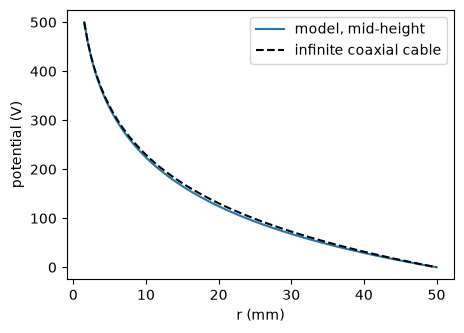

## 3. The gas

The gas is described by its **charge carriers** and the **reactions** between them.
In room air there are three carriers:

| Carrier | Charge $z$ | Role |
|---|---|---|
| electrons $e$ | −1 | created by ionisation, very mobile |
| positive ions $P$ | +1 | created by ionisation, slow |
| negative ions $N$ | −1 | made when an electron attaches to O₂, slow |

### Drift and diffusion

An ion in a gas is never in free flight. It moves at about 500 m/s in a random
direction and hits a gas molecule every 70 nm or so, which sends it off in a new
direction. Two things come out of this:

- **Drift.** The field pushes the ion a little between two collisions, always the
  same way. Averaged over many collisions, this is a steady velocity proportional
  to the field:

  $$
  v_s = -z_s \, \mu_s \, \nabla \varphi = z_s \, \mu_s \, E
  $$

  The mobility $\mu_s$ says how easily the carrier gets through the gas. Positive
  carriers go along the field (towards the can), negative ones against it (towards
  the rod). The drift (metres per second) is slow compared with the random motion.
- **Diffusion.** The random motion alone spreads the carriers from where they are
  many to where they are few, with the flux $-D_s \nabla n_s$. For ions, $D_s$
  follows from the mobility (Einstein relation, $D = \mu \, k_B T / e$), so it is not
  given. Electrons are heated by the field, so theirs is given.

A `ChargeCarrier` is a `festim.Species` with a charge and a mobility.

```python
electrons = ic.ChargeCarrier(name="e", charge=-1, mobility=0.04, diffusivity=0.04)
positive_ions = ic.ChargeCarrier(name="P", charge=1, mobility=2.0e-4)
negative_ions = ic.ChargeCarrier(name="N", charge=-1, mobility=2.2e-4)
```

### Reactions

- **Attachment.** Oxygen captures slow electrons: $e^- + \mathrm{O_2} \rightarrow
  \mathrm{O_2^-}$. The charge is not lost, but it now sits on a heavy ion that
  moves about 200 times slower than the electron did.
- **Recombination.** When a positive and a negative ion come close, the extra
  electron goes back and both become neutral molecules. An ion pair is lost, and
  with it its contribution to the current. A positive ion meets a negative one at a
  rate proportional to both densities, hence $\alpha \, n_P \, n_N$.

Three reactions, each with a mass-action rate:

| Reaction | Rate | |
|---|---|---|
| attachment: $e \rightarrow N$ | $\nu_a \, n_e$ | electrons become negative ions |
| ion recombination: $P + N \rightarrow$ neutral | $\alpha \, n_P \, n_N$ | the main loss |
| electron recombination: $P + e \rightarrow$ neutral | $\beta \, n_P \, n_e$ | negligible in air |

A `CarrierReaction` is a `festim.GenericReaction`.

```python
attachment = ic.CarrierReaction(reactant=electrons, product=negative_ions, rate=1.0e8)
ion_recombination = ic.CarrierReaction(
    reactant=[positive_ions, negative_ions], rate=2.0e-12
)
electron_recombination = ic.CarrierReaction(
    reactant=[positive_ions, electrons], rate=2.0e-13
)

air = ic.Gas(
    name="air",
    w_value=33.97,  # eV needed to make one ion pair
    density=1.205,  # kg/m3, sets the range of the betas
    carriers=[electrons, positive_ions, negative_ions],
    ionisation_products=(electrons, positive_ions),
    reactions=[attachment, ion_recombination, electron_recombination],
)
```

Two time scales follow from these numbers, and they explain most of what the model
shows:

- An electron attaches after $1 / \nu_a$ = 10 ns, so nearly all the negative charge
  travels as slow ions.
- An ion needs tens of milliseconds to cross the chamber. Integrating $dr / v$ in
  the coaxial field gives $t = (b^2 - a^2) \ln(b/a) / (2 \mu V)$.

The longer the ions stay in the gas, the more of them recombine.

The figure shows the drift speed of the ions, and the path of the two ions of a
pair created half-way between the rod and the can. The speed follows the field, so
ions are fast near the rod and slow near the can.

```python
transit_time = (b**2 - a**2) * np.log(b / a) / (2 * positive_ions.mobility * BIAS)
print(f"electron lifetime before attachment  {1 / attachment.rate * 1e9:.0f} ns")
print(f"time for an ion to cross the gap     {transit_time * 1e3:.0f} ms")

radius = np.linspace(a, b, 200)
field_strength = BIAS / (radius * np.log(b / a))

# an ion that starts at r0 is at r(t), from dr/dt = +/- mobility * E(r)
start_radius = 0.5 * (a + b)
time = np.linspace(0, 0.05, 500)
speed_factor = 2 * BIAS / np.log(b / a)
positive_squared = start_radius**2 + positive_ions.mobility * speed_factor * time
negative_squared = start_radius**2 - negative_ions.mobility * speed_factor * time
positive_path = np.sqrt(np.clip(positive_squared, None, b**2))
negative_path = np.sqrt(np.clip(negative_squared, a**2, None))

figure, axes = plt.subplots(1, 2, figsize=(10, 3.5))
axes[0].semilogy(radius * 1e3, positive_ions.mobility * field_strength)
axes[0].set_xlabel("r (mm)")
axes[0].set_ylabel("drift speed of a positive ion (m/s)")

axes[1].plot(time * 1e3, positive_path * 1e3, color="tab:red", label="positive ion")
axes[1].plot(time * 1e3, negative_path * 1e3, color="tab:blue", label="negative ion")
axes[1].axhline(b * 1e3, color="k", linewidth=0.5)
axes[1].axhline(a * 1e3, color="k", linewidth=0.5)
axes[1].text(49, b * 1e3 - 3, "can", ha="right")
axes[1].text(49, a * 1e3 + 1.5, "rod", ha="right")
axes[1].set_xlabel("time after the pair is created (ms)")
axes[1].set_ylabel("r (mm)")
axes[1].legend(loc="center right")
figure.tight_layout()
plt.show()
```

```text
electron lifetime before attachment  10 ns
time for an ion to cross the gap     44 ms
```

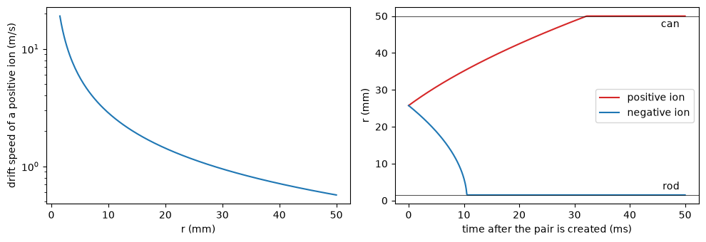

## 4. The source of ion pairs

### What an ion pair is

The beta is a fast electron. When it passes close to a gas molecule, it can knock
one of the molecule's electrons out:

$$
\beta + \mathrm{N_2} \rightarrow \beta + \mathrm{N_2^+} + e^-
$$

What is left is a free electron and a positive ion: one **ion pair**. Before, the
gas was neutral and could carry no current. Now it holds two charges that the field
can move.

Each ionisation costs the beta some energy, so it slows down and, after a few
hundred of them, stops. On average it spends $W$ = 34 eV per pair in air. That is
about twice the energy needed to pull an electron off N₂ (15.6 eV): the rest goes
into collisions that excite a molecule without ionising it. So a beta of energy
$E$ makes $E / W$ pairs, wherever it goes.

### The source term

Tritium mixed into the gas at the activity concentration $A$ creates ion pairs at
the local rate

$$
S(r, z) = A \, \frac{\bar{E}}{W} \, f(r, z)
$$

- $\bar{E}$ is the mean energy of a tritium beta. It comes from the beta spectrum
  below.
- $\bar{E} / W$ is the number of ion pairs one decay makes if the beta stops in the
  gas.
- $f(r, z)$, between 0 and 1, is the share of the beta energy that a decay at
  $(r, z)$ leaves in the gas. This is the wall loss.

```python
energies, spectrum = ic.beta.beta_spectrum()
mean_energy = ic.beta.mean_energy()
pairs_per_decay = ic.beta.ion_pairs_per_decay(air.w_value)

plt.figure(figsize=(5, 3.5))
plt.plot(energies / 1e3, spectrum * 1e3)
plt.axvline(mean_energy / 1e3, color="k", linestyle="--", label="mean energy")
plt.xlabel("beta energy (keV)")
plt.ylabel("probability density (1/keV)")
plt.legend()
plt.show()

print(f"mean beta energy     {mean_energy / 1e3:.2f} keV")
print(f"ion pairs per decay  {pairs_per_decay:.1f}")
```

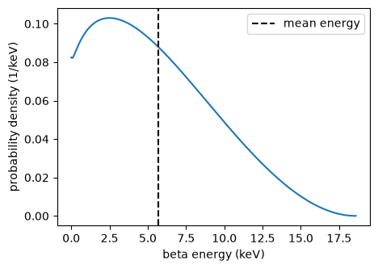

```text
mean beta energy     5.70 keV
ion pairs per decay  167.7
```

### The track of a beta

A beta travels a finite distance in the gas, its range: at most 4.9 mm in air, and
0.4 mm at the mean energy. The figure follows a beta of the mean energy with the
range-energy relation the model uses. The beta loses energy faster as it slows
down, so the pairs are closer together at the end of the track.

The track is short compared with the 48.5 mm between the rod and the can. This is why
the model does not follow tracks: it creates the pairs at the point of the decay.

```python
range_at_endpoint = ic.beta.mass_range(ic.beta.Q_BETA) / air.density
range_at_mean_energy = ic.beta.mass_range(mean_energy) / air.density
print(f"range in air at the endpoint energy  {range_at_endpoint * 1e3:.1f} mm")
print(f"range in air at the mean energy      {range_at_mean_energy * 1e3:.2f} mm")

# the energy the beta still has after each distance travelled
distance = np.linspace(0, range_at_mean_energy, 2000)
remaining_range = (range_at_mean_energy - distance) * air.density
energy_along_track = ic.beta.energy_from_mass_range(remaining_range)

# one ion pair every time the beta has lost W
number_of_pairs = int(mean_energy / air.w_value)
energy_lost = mean_energy - energy_along_track
energy_lost_at_each_pair = air.w_value * np.arange(1, number_of_pairs + 1)
pair_positions = np.interp(energy_lost_at_each_pair, energy_lost, distance)

figure, axes = plt.subplots(2, 1, figsize=(8, 4), sharex=True, height_ratios=[2, 1])
axes[0].plot(distance * 1e3, energy_along_track / 1e3)
axes[0].set_ylabel("energy of the beta (keV)")

axes[1].plot(
    pair_positions * 1e3,
    np.full(number_of_pairs, 0.3),
    "o",
    color="tab:red",
    markersize=2,
    label="positive ions",
)
axes[1].plot(
    pair_positions * 1e3,
    np.full(number_of_pairs, -0.3),
    "o",
    color="tab:blue",
    markersize=2,
    label="electrons",
)
axes[1].set_ylim(-1, 1)
axes[1].set_yticks([])
axes[1].set_xlabel("distance along the track (mm)")
axes[1].legend(ncols=2, loc="lower left", fontsize=8)
axes[1].set_title(f"the {number_of_pairs} ion pairs", fontsize=10)
figure.tight_layout()
plt.show()
```

```text
range in air at the endpoint energy  4.9 mm
range in air at the mean energy      0.39 mm
```

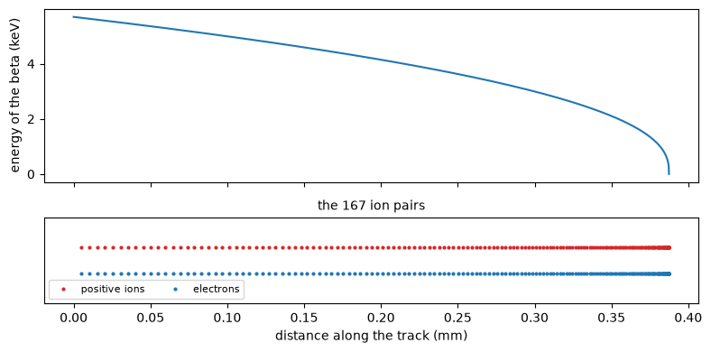

### Wall losses

A decay closer to a wall than the range of its beta can lose energy to the metal.
That energy makes no ion pairs in the gas, so it is lost for the reading.

$f(r, z)$ is computed by a Monte Carlo. From each point, betas are drawn from the
spectrum, sent in random directions and followed in straight lines. A beta that
reaches a wall deposits there the energy it still has.

The figure shows 300 such betas from a point 0.5 mm from the can, seen from above.
The ones in red reach the wall.

```python
decay_point = np.array([[chamber.can_radius - 0.5e-3, mid_height]])
ray_energies, ray_directions = ic.beta.sample_decays(n_rays=300)
ray_ranges = ic.beta.mass_range(ray_energies) / air.density
distances_to_wall = chamber.distance_to_wall(decay_point, ray_directions)[0]
track_lengths = np.minimum(ray_ranges, distances_to_wall)
reaches_wall = distances_to_wall < ray_ranges

plt.figure(figsize=(5, 5))
for i in range(len(track_lengths)):
    end_x = decay_point[0, 0] + track_lengths[i] * ray_directions[i, 0]
    end_y = track_lengths[i] * ray_directions[i, 1]
    colour = "tab:red" if reaches_wall[i] else "0.6"
    plt.plot(
        [decay_point[0, 0] * 1e3, end_x * 1e3],
        [0, end_y * 1e3],
        color=colour,
        linewidth=0.6,
    )
angle = np.linspace(-0.1, 0.1, 100)
plt.plot(b * np.cos(angle) * 1e3, b * np.sin(angle) * 1e3, "k", linewidth=3)
plt.text(50.2, 2.6, "wall")
plt.xlim(46, 51)
plt.ylim(-3, 3)
plt.gca().set_aspect("equal")
plt.xlabel("x (mm)")
plt.ylabel("y (mm)")
plt.show()

print(f"betas that reach the wall  {reaches_wall.mean() * 100:.0f} %")
```

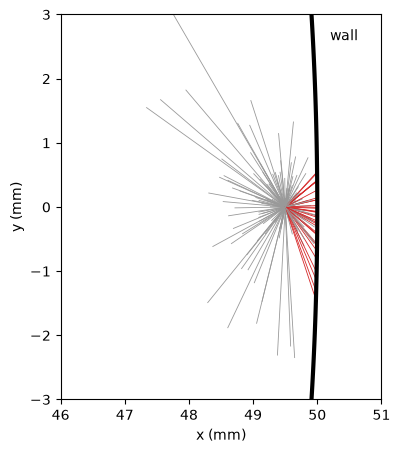

```text
betas that reach the wall  11 %
```

```python
tritium = ic.TritiumInGas(activity=1.0 * BQ_PER_CI, geometry=chamber)  # 1 Ci/m3
```

## 5. The transport of the charges

Each carrier $s$ has a number density $n_s$ (m⁻³). In steady state, what flows out
of a small volume equals what is created in it:

$$
\nabla \cdot J_s = S_s + R_s, \qquad
J_s = \underbrace{-D_s \nabla n_s}_\text{diffusion}
    + \underbrace{n_s \, v_s}_\text{drift}
$$

This is the Nernst–Planck equation. For air, with the source and the reactions of
sections 3 and 4:

$$
\begin{aligned}
\nabla \cdot J_e &= S - \nu_a n_e - \beta \, n_P n_e \\
\nabla \cdot J_P &= S - \alpha \, n_P n_N - \beta \, n_P n_e \\
\nabla \cdot J_N &= \nu_a n_e - \alpha \, n_P n_N
\end{aligned}
$$

The three equations are coupled through the reactions, and the recombination terms
make them nonlinear.

**Boundary conditions.** An electrode absorbs the carriers the field drives into
it, and emits none. So the anode absorbs electrons and negative ions, and the
density of positive ions is zero there; the cathode is the opposite. Insulators let
nothing through.

**This is a FESTIM problem.** `ChargeTransportProblem` is a child of
`festim.HydrogenTransportProblem`. During `initialise()` it turns the inputs into
FESTIM objects:

| Here | FESTIM |
|---|---|
| carriers | `species` |
| carrier reactions | `reactions` |
| ionisation source | one `ParticleSource` for each of the two ionisation products |
| drift in the potential | `drift_terms` (electromigration) |
| electrodes | `OutflowBC` or `FixedConcentrationBC` of zero |

**One numerical point.** Ions are carried by the field far more than they diffuse,
and standard finite elements oscillate in that regime. The problem therefore raises
the diffusion coefficient in each cell to at least $\tfrac{1}{2} \mu |E| h$, with
$h$ the cell size along the field (an upwind scheme). The error this leaves is
proportional to the cell size: section 6 shows how to remove it.

The exports are created first, each with the surface or the volume it is computed
on, and given to the problem as in FESTIM.

```python
current = ic.ChamberCurrent(surface=chamber.anode)
ideal_current = ic.IdealCurrent(volume=chamber.gas)
wall_efficiency = ic.WallEfficiency(volume=chamber.gas)
collection_efficiency = ic.CollectionEfficiency(volume=chamber.gas)
pair_generation = ic.PairGeneration(volume=chamber.gas)
recombination = ic.Recombination(volume=chamber.gas)
space_charge_field = ic.SpaceChargeField(volume=chamber.gas)

transport = ic.ChargeTransportProblem()
transport.electrostatic_problem = electrostatics
transport.gas = air
transport.ionisation_sources = [tritium]
transport.exports = [
    current,
    ideal_current,
    wall_efficiency,
    collection_efficiency,
    pair_generation,
    recombination,
    space_charge_field,
]
transport.initialise()
transport.run()
```

### The wall-loss efficiency

The source computed $f(r, z)$ when the problem was initialised. It is 1 in the bulk
of the gas and falls to about 0.5 at a wall, where half of the betas are emitted
towards the metal. The layer is about 2 mm thick, so in a 1 L chamber it is a small
share of the volume.

The map is the efficiency on the mesh. The curve is the Monte Carlo result itself,
on its own grid, which is finer near the walls than the mesh.

```python
plot_field(tritium.efficiency, label="wall-loss efficiency f", vmin=0.5, vmax=1.0)
plt.show()

grid_r, grid_z, grid_efficiency = ic.beta.efficiency_grid(chamber, air.density)
middle = len(grid_z) // 2
plt.figure(figsize=(5, 3.5))
plt.plot((b - grid_r) * 1e3, grid_efficiency[:, middle], "o-", markersize=3)
plt.xlim(0, 6)
plt.xlabel("distance from the can (mm)")
plt.ylabel("wall-loss efficiency f")
plt.show()
```

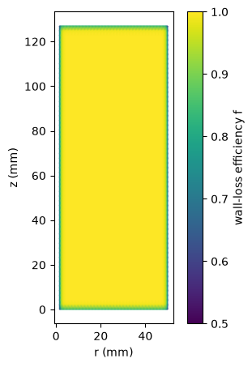

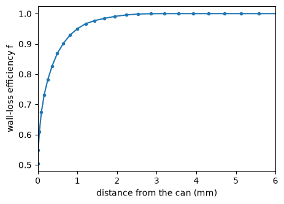

### The carrier densities

The solution is the density of each carrier. Positive ions are created everywhere
and drift outwards, so they pile up towards the cathode. Negative ions drift
inwards to the rod. The electron density is millions of times smaller: electrons
attach almost where they are created.

```python
plt.figure(figsize=(5, 3.5))
for carrier in air.carriers:
    r, density = radial_profile(carrier.post_processing_solution, height=mid_height)
    plt.plot(r * 1e3, density, label=carrier.name)
plt.yscale("log")
plt.ylim(1e3, 1e14)
plt.xlabel("r (mm)")
plt.ylabel("density at mid-height (1/m³)")
plt.legend()
plt.show()

plot_field(positive_ions.post_processing_solution, label="positive ions (1/m³)")
plt.show()
```

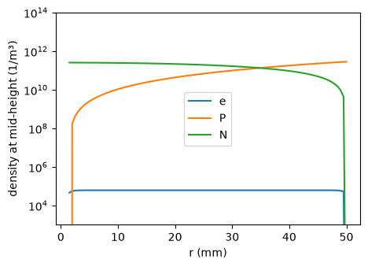

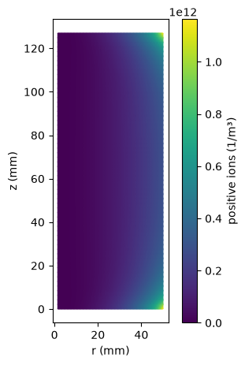

### Where the pairs recombine

The local loss rate is $\alpha \, n_P \, n_N$. It needs both kinds of ion in the
same place. It is largest in the corners between the can and the end caps, where
the field is weakest and the ions slowest.

```python
r_nodes, z_nodes, node_triangles, positive_density = values_at_nodes(
    positive_ions.post_processing_solution
)
_, _, _, negative_density = values_at_nodes(negative_ions.post_processing_solution)
recombination_rate = ion_recombination.rate * positive_density * negative_density

plt.figure(figsize=(4.5, 5))
plt.tripcolor(
    r_nodes * 1e3, z_nodes * 1e3, node_triangles, recombination_rate, shading="gouraud"
)
plt.colorbar(label="recombination rate (pairs/m³/s)")
plt.xlabel("r (mm)")
plt.ylabel("z (mm)")
plt.gca().set_aspect("equal")
plt.show()
```

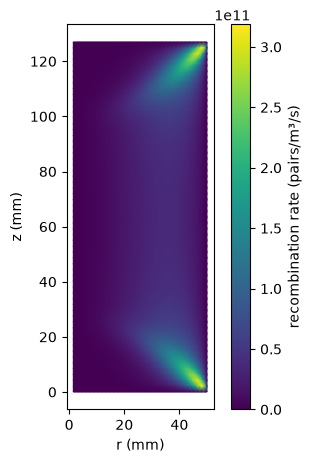

## 6. The exports: what the chamber reads

Each export is one number, in `value` after the run.

| Export | Definition | Meaning |
|---|---|---|
| `IdealCurrent` | $e \, A \, V_\mathrm{gas} \, \bar{E} / W$ | the current with no loss at all |
| `PairGeneration` | $G = \int S \, dV$ | ion pairs created per second |
| `Recombination` | $R = \int (\alpha \, n_P n_N + \beta \, n_P n_e) \, dV$ | ion pairs lost per second |
| `WallEfficiency` | $e \, G / I_\mathrm{ideal}$ | share of the beta energy left in the gas |
| `CollectionEfficiency` | $(G - R) / G$ | share of the pairs that are collected |
| `ChamberCurrent` | see below | the reading |
| `SpaceChargeField` | $\lVert \nabla\varphi_1 \rVert / \lVert \nabla\varphi \rVert$ | how much the charge in the gas would distort the field |

The chamber current is the current induced on the readout electrode by the moving
charges (Shockley–Ramo theorem):

$$
I = e \int \sum_s z_s \, J_s \cdot (-\nabla \varphi_w) \, dV,
\qquad \varphi_w = \varphi / V
$$

In steady state it equals the current that flows through the electrode. It is an
integral over the gas, which makes it more accurate than integrating the flux on the
electrode surface.

```python
print(f"ideal current          {ideal_current.value:.3e} A")
print(f"pair generation        {pair_generation.value:.3e} 1/s")
print(f"recombination          {recombination.value:.3e} 1/s")
print(f"wall efficiency        {wall_efficiency.value:.4f}")
print(f"collection efficiency  {collection_efficiency.value:.4f}")
print(f"chamber current        {current.value:.3e} A")
print(f"space-charge field     {space_charge_field.value:.4f}")
```

```text
ideal current          9.906e-10 A
pair generation        6.118e+09 1/s
recombination          4.297e+07 1/s
wall efficiency        0.9894
collection efficiency  0.9930
chamber current        9.571e-10 A
space-charge field     0.0032
```

**Reading these numbers.** At 1 Ci/m³ and 500 V, about 1% of the beta energy goes to
the walls and under 1% of the pairs recombine. The space-charge field is 0.3% of the
applied field, so neglecting it was justified.

The chain $I = I_\mathrm{ideal} \times \eta_\mathrm{wall} \times
\eta_\mathrm{collection}$ does not close exactly on this mesh: the current is
about 2% lower. That gap is the discretisation error of the upwind scheme, not
physics. It shrinks in proportion to the cell size, so two meshes are enough to
remove it.

```python
expected_current = (
    ideal_current.value * wall_efficiency.value * collection_efficiency.value
)
print(f"ideal x wall x collection  {expected_current:.3e} A")
print(f"chamber current            {current.value:.3e} A")
print(
    f"difference                 {(1 - current.value / expected_current) * 100:.1f} %"
)
```

```text
ideal x wall x collection  9.733e-10 A
chamber current            9.571e-10 A
difference                 1.7 %
```

### Removing the mesh error

Solve on a mesh and on one twice as fine, then extrapolate to a cell size of zero:

$$
I_\mathrm{extrapolated} = I_\mathrm{fine} + (I_\mathrm{fine} - I_\mathrm{coarse})
$$

A problem is initialised once, and carriers hold the solution of their problem. A
second mesh therefore needs new problems and a new gas, which is why everything is
built inside a function here.

```python
def create_air():
    """The same air as in section 3, made of new carrier objects."""
    e = ic.ChargeCarrier(name="e", charge=-1, mobility=0.04, diffusivity=0.04)
    P = ic.ChargeCarrier(name="P", charge=1, mobility=2.0e-4)
    N = ic.ChargeCarrier(name="N", charge=-1, mobility=2.2e-4)
    return ic.Gas(
        name="air",
        w_value=33.97,
        density=1.205,
        carriers=[e, P, N],
        ionisation_products=(e, P),
        reactions=[
            ic.CarrierReaction(reactant=e, product=N, rate=1.0e8),
            ic.CarrierReaction(reactant=[P, N], rate=2.0e-12),
            ic.CarrierReaction(reactant=[P, e], rate=2.0e-13),
        ],
    )


def solve_current(radial_cells, axial_cells):
    """The chamber current at 1 Ci/m3 and 500 V on a given mesh."""
    potential_problem = ic.ElectrostaticProblem()
    potential_problem.mesh = chamber.create_mesh(
        radial_cells=radial_cells, axial_cells=axial_cells
    )
    potential_problem.subdomains = [chamber.gas, chamber.anode, chamber.cathode]
    potential_problem.boundary_conditions = [
        ic.FixedPotentialBC(subdomain=chamber.anode, value=BIAS),
        ic.FixedPotentialBC(subdomain=chamber.cathode, value=0.0),
    ]
    potential_problem.initialise()
    potential_problem.run()

    reading = ic.ChamberCurrent(surface=chamber.anode)
    charge_problem = ic.ChargeTransportProblem()
    charge_problem.electrostatic_problem = potential_problem
    charge_problem.gas = create_air()
    charge_problem.ionisation_sources = [
        ic.TritiumInGas(activity=1.0 * BQ_PER_CI, geometry=chamber)
    ]
    charge_problem.exports = [reading]
    charge_problem.initialise()
    charge_problem.run()
    return reading.value


current_coarse = current.value  # 100 x 60 cells, from above
current_fine = solve_current(radial_cells=200, axial_cells=120)
current_extrapolated = current_fine + (current_fine - current_coarse)

print(f"100 x 60 cells    {current_coarse:.3e} A")
print(f"200 x 120 cells   {current_fine:.3e} A")
print(f"extrapolated      {current_extrapolated:.3e} A")
print(f"ideal x wall x collection  {expected_current:.3e} A")
```

```text
100 x 60 cells    9.571e-10 A
200 x 120 cells   9.656e-10 A
extrapolated      9.741e-10 A
ideal x wall x collection  9.733e-10 A
```

### The response curve

The question a monitor has to answer is: **over which range is the current
proportional to the activity?**

The activity of a source can be changed between runs without rebuilding the
problem, so a sweep is a loop. Each export keeps the value of every run in `data`.

```python
activities_in_curie = np.logspace(-2, 3, 11)  # Ci/m3

first_run_of_sweep = len(current.data)
for activity in activities_in_curie:
    tritium.activity = activity * BQ_PER_CI
    transport.run()

sweep_current = np.array(current.data[first_run_of_sweep:])
sweep_collection = np.array(collection_efficiency.data[first_run_of_sweep:])
sweep_space_charge = np.array(space_charge_field.data[first_run_of_sweep:])
sweep_wall = np.array(wall_efficiency.data[first_run_of_sweep:])
```

```python
figure, axes = plt.subplots(1, 3, figsize=(13, 3.6))

axes[0].loglog(activities_in_curie, sweep_current, "o-", label="model")
proportional = sweep_current[0] * activities_in_curie / activities_in_curie[0]
axes[0].loglog(activities_in_curie, proportional, "k--", label="proportional")
axes[0].set_ylabel("chamber current (A)")
axes[0].legend()

axes[1].semilogx(activities_in_curie, sweep_collection, "o-")
axes[1].set_ylabel("collection efficiency")

axes[2].loglog(activities_in_curie, sweep_space_charge, "o-")
axes[2].axhline(0.1, color="k", linestyle="--")
axes[2].set_ylabel("space-charge field / applied field")

for axis in axes:
    axis.set_xlabel("activity (Ci/m³)")
figure.tight_layout()
plt.show()
```

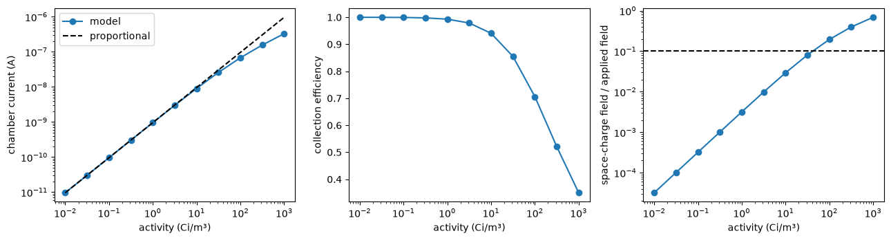

**What the exports show.**

- **Left.** The current follows the activity at low activity, then falls below the
  proportional line: the chamber saturates.
- **Middle.** The reason is recombination. Pairs are created in proportion to $A$,
  but they recombine in proportion to $n_P \, n_N \propto A^2$, so the share lost
  grows with the activity.
- **Right.** The charge in the gas also grows with the activity. Above the dashed
  line (0.1) the fixed-potential assumption of section 2 no longer holds, and the
  results beyond it are indicative only.

The last figure puts the two losses side by side: of the energy of the betas, the
share that ends as collected charge, the share lost to recombination and the share
lost to the walls. The wall loss does not depend on the activity; recombination
does.

The design studies in `examples/` do the same for the bias and the chamber shape,
with new problems built for each case.

```python
share_collected = sweep_wall * sweep_collection
share_recombined = sweep_wall * (1 - sweep_collection)
share_in_walls = 1 - sweep_wall

plt.figure(figsize=(6, 3.5))
plt.stackplot(
    activities_in_curie,
    share_collected,
    share_recombined,
    share_in_walls,
    labels=["collected", "lost to recombination", "lost to the walls"],
    colors=["tab:green", "tab:orange", "tab:gray"],
)
plt.xscale("log")
plt.xlim(activities_in_curie[0], activities_in_curie[-1])
plt.ylim(0, 1)
plt.xlabel("activity (Ci/m³)")
plt.ylabel("share of the beta energy")
plt.legend(loc="lower left")
plt.show()
```

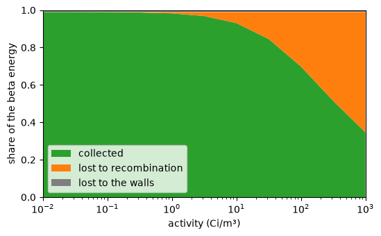

## Memory effects: coupling FESTIM to the chamber

### The effect

During a measurement, tritium from the gas enters the chamber walls and the anode.
When the chamber is purged with clean gas, that tritium is still there. It produces
a current although the gas is clean: a **background**. Each exposure adds to the
inventory in the metal, so the background grows from run to run.

The tritium in the wall reaches the reading in two ways:

1. **Release.** Tritium leaves the wall and mixes with the gas. It then behaves as
   tritium in the gas, with an activity set by the release rate.
2. **Direct betas.** Tritium that decays just below the surface can emit its beta
   into the gas. Only a very thin layer contributes, because a beta is stopped by
   less than a micrometre of steel (see below).

```python
steel_density = 7900.0  # kg/m3
range_in_steel = ic.beta.mass_range(ic.beta.Q_BETA) / steel_density
print(f"range of a tritium beta in steel, at most  {range_in_steel * 1e6:.2f} µm")
```

```text
range of a tritium beta in steel, at most  0.74 µm
```

### Why the coupling is simple

The two models live on very different time scales:

| | Time scale | Model |
|---|---|---|
| Charges cross the chamber | tens of milliseconds | steady-state chamber problem |
| Tritium moves in the wall | hours to months | transient FESTIM problem |

So the chamber is always in steady state for the wall inventory of the moment, and
the two problems never have to be solved together. The coupling is one way and
sequential:

1. **FESTIM steps the wall in time** through the history of exposures and purges.
   The gas activity sets the boundary condition on the wall surface.
2. **At each reading time**, the wall problem gives a release flux and a
   near-surface inventory.
3. **These become ionisation sources** of the chamber problem, which is solved as a
   steady state. Its current is the background.

### A sketch with what exists today

The release route needs nothing new: the released tritium is tritium in the gas, so
it enters through `TritiumInGas.activity`. The sketch below does this for five
cycles of one hour of exposure at 1 Ci/m³ followed by one hour of purge.

#### The wall

A 1D FESTIM model through the thickness of the wall, with $x = 0$ the surface in
contact with the gas:

$$
\frac{\partial c}{\partial t} = \nabla \cdot (D \nabla c), \qquad
c(0, t) = \begin{cases} K_S \sqrt{p_\mathrm{T_2}} & \text{during an exposure} \\
0 & \text{during a purge} \end{cases}
$$

with $c$ the tritium concentration in the metal, $D$ its diffusion coefficient,
$K_S$ the solubility and $p_\mathrm{T_2}$ the partial pressure of tritium in the gas
(Sieverts' law). At room temperature tritium only gets a few micrometres into steel
in an hour, so a 50 µm layer is enough.

```python
K_BOLTZMANN = 1.380649e-23  # J/K
DECAY_CONSTANT = np.log(2) / (12.32 * 365.25 * 24 * 3600)  # of tritium, 1/s
TEMPERATURE = 293.15  # K

# the history of the chamber
EXPOSURE_ACTIVITY = 1.0 * BQ_PER_CI  # Bq/m3
EXPOSURE_TIME = 3600.0  # s
PURGE_TIME = 3600.0  # s
NUMBER_OF_CYCLES = 5
PURGE_FLOW = 1.0e-3 / 60  # m3/s (1 L/min of clean gas)

# the wall: illustrative values of the order of those of an austenitic steel
D_0 = 7.0e-7  # m2/s
E_D = 0.50  # eV
SOLUBILITY = 1.5e22  # atoms/m3/Pa^0.5 at room temperature

# the concentration at the wall surface during an exposure, from Sieverts' law
atoms_in_gas = EXPOSURE_ACTIVITY / DECAY_CONSTANT  # tritium atoms per m3 of gas
partial_pressure = 0.5 * atoms_in_gas * K_BOLTZMANN * TEMPERATURE  # Pa of T2
surface_concentration = SOLUBILITY * np.sqrt(partial_pressure)  # atoms/m3

print(f"tritium partial pressure at 1 Ci/m3   {partial_pressure:.3f} Pa")
print(f"concentration at the wall surface     {surface_concentration:.2e} atoms/m3")
```

```text
tritium partial pressure at 1 Ci/m3   0.042 Pa
concentration at the wall surface     3.07e+21 atoms/m3
```

```python
def concentration_at_surface(t):
    """The surface concentration: the Sieverts value during the exposures, else 0."""
    time_in_cycle = t % (EXPOSURE_TIME + PURGE_TIME)
    if time_in_cycle < EXPOSURE_TIME:
        return float(surface_concentration)
    return 0.0


WALL_DEPTH = 50e-6  # m
# cells far below a nanometre at the surface, growing with depth
wall_vertices = WALL_DEPTH * np.linspace(0, 1, 400) ** 3

steel = F.Material(D_0=D_0, E_D=E_D)
wall_volume = F.VolumeSubdomain1D(id=1, borders=[0, WALL_DEPTH], material=steel)
gas_side = F.SurfaceSubdomain1D(id=1, x=0)
tritium_in_wall = F.Species("T")

release_flux = F.SurfaceFlux(field=tritium_in_wall, surface=gas_side)
wall_inventory = F.TotalVolume(field=tritium_in_wall, volume=wall_volume)

wall = F.HydrogenTransportProblem()
wall.mesh = F.Mesh1D(vertices=wall_vertices)
wall.subdomains = [wall_volume, gas_side]
wall.species = [tritium_in_wall]
wall.temperature = TEMPERATURE
wall.boundary_conditions = [
    F.FixedConcentrationBC(
        subdomain=gas_side, value=concentration_at_surface, species=tritium_in_wall
    )
]
wall.exports = [release_flux, wall_inventory]
wall.settings = F.Settings(
    atol=1e6,
    rtol=1e-10,
    final_time=NUMBER_OF_CYCLES * (EXPOSURE_TIME + PURGE_TIME),
    stepsize=30.0,
)
wall.show_progress_bar = False
wall.initialise()
wall.run()
```

#### From the wall to the gas

During a purge, the wall releases the flux $\varphi_\mathrm{out}$ (atoms/m²/s) into
a stream of clean gas of flow rate $Q$. The activity of the gas in the chamber
settles at

$$
A_\mathrm{background} = \frac{\lambda \, \varphi_\mathrm{out} \, S_\mathrm{wall}}{Q}
$$

with $\lambda$ the decay constant of tritium and $S_\mathrm{wall}$ the area of metal
in contact with the gas (can, end caps and rod).

```python
wall_area = (
    2 * np.pi * chamber.can_radius * chamber.length
    + 2 * np.pi * (chamber.can_radius**2 - chamber.rod_radius**2)
    + 2 * np.pi * chamber.rod_radius * chamber.length
)

times = np.array(release_flux.t)
flux_out_of_wall = np.array(release_flux.data)
# tritium leaves the wall during the purges only; during an exposure it enters
is_purge = times % (EXPOSURE_TIME + PURGE_TIME) >= EXPOSURE_TIME
flux_out_of_wall[~is_purge] = np.nan
background_activity = DECAY_CONSTANT * flux_out_of_wall * wall_area / PURGE_FLOW

# each reading is taken at the end of a purge: the last time step before the next
# exposure starts
reading_times = []
reading_activities = []
for cycle in range(NUMBER_OF_CYCLES):
    end_of_purge = (cycle + 1) * (EXPOSURE_TIME + PURGE_TIME)
    index = np.searchsorted(times, end_of_purge - 1e-6) - 1
    reading_times.append(times[index])
    reading_activities.append(float(background_activity[index]))

figure, axes = plt.subplots(1, 2, figsize=(11, 3.6))
axes[0].plot(times / 3600, np.array(wall_inventory.data))
axes[0].set_ylabel("tritium in the wall (atoms/m²)")

axes[1].semilogy(times / 3600, background_activity / BQ_PER_CI)
axes[1].semilogy(
    np.array(reading_times) / 3600,
    np.array(reading_activities) / BQ_PER_CI,
    "ko",
    label="readings",
)
axes[1].set_ylabel("gas activity during the purges (Ci/m³)")
axes[1].legend()

for axis in axes:
    axis.set_xlabel("time (h)")
figure.tight_layout()
plt.show()
```

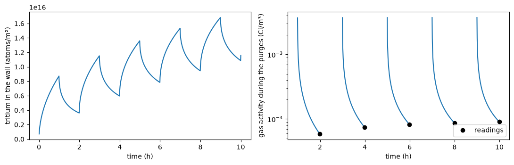

The inventory in the wall rises during each exposure and only partly comes back out
during the purge: the tritium that diffused deepest stays. This is the memory.

#### From the gas to the current

The last step is the chamber model of this page: set the activity of the source
to the background activity and solve. This is the current the chamber reads with
clean gas flowing through it.

```python
first_background_run = len(current.data)
for activity in reading_activities:
    tritium.activity = activity
    transport.run()
background_currents = np.array(current.data[first_background_run:])

tritium.activity = EXPOSURE_ACTIVITY
transport.run()
signal_current = current.value

runs = np.arange(1, NUMBER_OF_CYCLES + 1)
plt.figure(figsize=(5, 3.5))
plt.plot(runs, background_currents * 1e15, "o-")
plt.xticks(runs)
plt.xlabel("run")
plt.ylabel("background current (fA)")
plt.show()

print(f"signal at 1 Ci/m3          {signal_current:.2e} A")
for run, background in zip(runs, background_currents):
    share = background / signal_current
    print(
        f"background after run {run}    {background:.2e} A  ({share:.1e} of the signal)"
    )
```

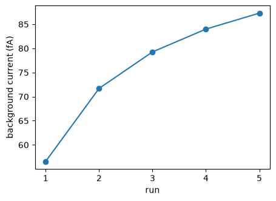

```text
signal at 1 Ci/m3          9.57e-10 A
background after run 1    5.66e-14 A  (5.9e-05 of the signal)
background after run 2    7.17e-14 A  (7.5e-05 of the signal)
background after run 3    7.93e-14 A  (8.3e-05 of the signal)
background after run 4    8.40e-14 A  (8.8e-05 of the signal)
background after run 5    8.73e-14 A  (9.1e-05 of the signal)
```

The background grows with every run, as the inventory does. **The numbers
themselves mean little**: the wall data are illustrative. The sketch is there to show
the chain: exposure history → FESTIM wall problem → release flux → gas activity →
chamber current.

### What a real coupling needs

1. **A source for the direct betas**, `TritiumOnWall`, a child of
   `IonisationSource`. It would take the near-surface inventory from the FESTIM
   problem (Bq/m² within the beta range of the surface) and put the ion pairs in the
   few millimetres of gas next to that wall. It needs the reverse of today's
   wall-loss Monte Carlo: betas start in the metal and the energy they bring into the
   gas is counted. A transport problem already sums several sources, so it sits next
   to `TritiumInGas`.
2. **Better wall physics.** At room temperature, the memory of a real chamber is
   often dominated by the surface (oxide layer, adsorbed water, isotope exchange) and
   not by diffusion in the bulk. FESTIM's surface kinetics or trapping can replace
   the Sieverts condition used here. This is where measured data is needed most.
3. **A wall problem for each material.** The can and the anode can be two FESTIM
   problems (or two subdomains), each with its own area and source.
4. **A balance for the gas.** Here the gas activity during a purge is the simple
   ratio of release to flow. A closed chamber, or a slow purge, needs the balance
   $V \, dA/dt = \lambda \, \varphi_\mathrm{out} \, S_\mathrm{wall} - Q \, A$,
   stepped together with the wall problem.
5. **A small class that runs the sequence**: step the wall, and solve the chamber
   when a reading is wanted. Because the coupling is one way, this is a loop and not
   an iteration.
